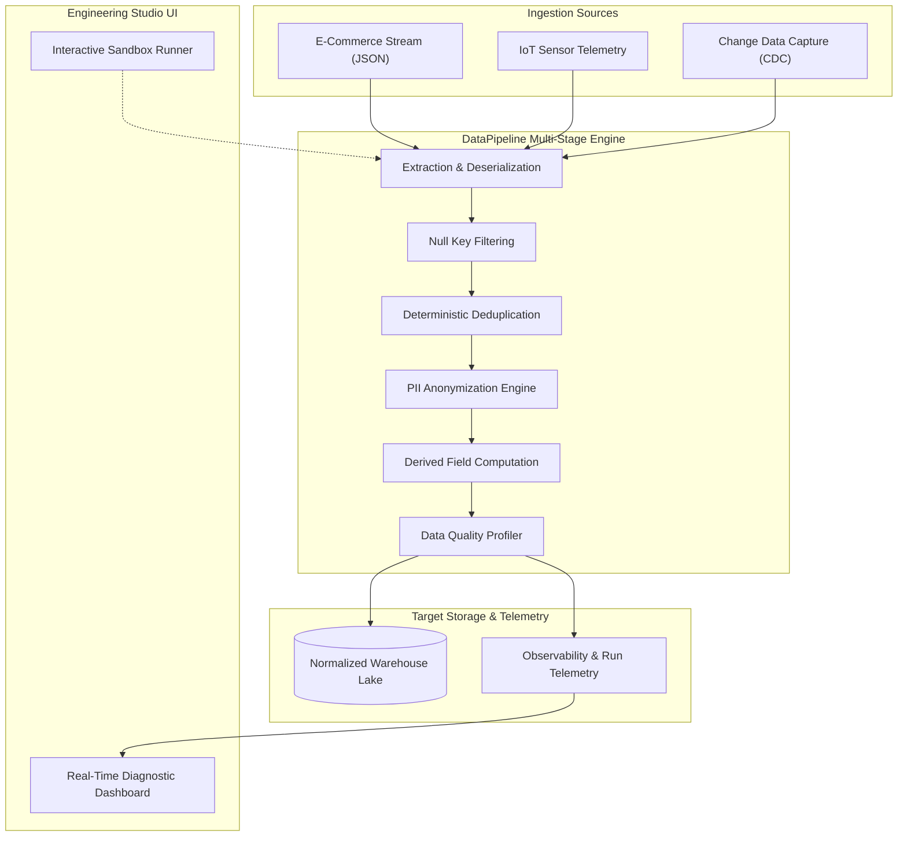

# DataPipeline — Automated ETL Framework & Streaming Data Quality Studio

[](https://github.com/Soulofghost/datapipeline/actions)
[](LICENSE)
[](https://www.python.org/)
[](https://fastapi.tiangolo.com)
[]()

> **DataPipeline** is an enterprise-grade automated streaming and micro-batch ETL (Extract, Transform, Load) orchestration framework engineered for modern data engineering teams. It features multi-stage deterministic data pipelines, zero-dependency in-memory transformations, automated deduplication, PII field masking (compliance with GDPR/HIPAA), schema validation, and real-time automated data quality profiling.

---

## 1. Problem Statement

Modern data infrastructures face severe operational friction when bridging heterogeneous raw event streams (IoT telemetry, e-commerce orders, CDC logs) and normalized target data warehouses:
- **Data Quality Decay:** Dirty data containing unhandled null keys, schema drift, and unexpected types silently infect downstream analytical models and operational dashboards.
- **Privacy Violations (PII Leaks):** Raw customer records containing plain-text emails, phone numbers, and financial tokens violate GDPR, CCPA, and HIPAA compliance policies when dumped into data lakes unmasked.
- **Pipeline Fragility & High Latency:** Bulky JVM-based frameworks often impose massive operational overhead for sub-second micro-batch transformations and real-time ingestion pipelines.
- **Opaque Observability:** Engineering teams lack immediate visibility into row-level throughput, duplicate ratios, and execution profiling metrics.

---

## 2. Core Value Proposition

DataPipeline provides a lean, deterministic, high-throughput ETL framework:
- **Sub-Millisecond In-Memory Transforms:** Micro-batch pipelines process thousands of records in single-digit milliseconds without external JVM or distributed engine dependencies.
- **Autonomous PII Masking:** Built-in regular-expression anonymization engine automatically masks sensitive fields (emails: `s***@domain.com`, phones: `***-***-0199`) prior to target ingestion.
- **Configurable Deduplication & Null Pruning:** Dynamic pipeline rules automatically eliminate redundant records and drop incomplete records based on designated deduplication keys.
- **Automated Data Quality Profiling:** Computes null ratios, duplicate rates, and field-level distribution metrics on every ingestion run, generating an overarching Data Quality Index score (0–100%).
- **Interactive Engineering Console:** Single-page monitoring studio allows data platform engineers to inspect run metrics, execute interactive transforms in a sandbox, and browse normalized lake tables.

---

## 3. System Architecture

The following diagram illustrates the lifecycle of records as they traverse DataPipeline's multi-stage transform engine:



---

## 4. Pipeline Execution Stages

DataPipeline enforces a deterministic 6-stage transformation sequence:

1. **Stage 1: Ingestion & Validation**
   Validates incoming JSON payloads against pipeline configuration definitions and parses raw data into typed dictionary records.
2. **Stage 2: Null Key Pruning**
   Discards records where mandatory identifier fields (e.g., `order_id`, `sensor_id`, `user_id`) evaluate to null or empty strings.
3. **Stage 3: Deduplication**
   Maintains a deterministic hash set of encountered keys to purge redundant records within the ingestion batch.
4. **Stage 4: PII Masking & Privacy Anonymization**
   Applies deterministic cryptographic masking to sensitive fields:
   - Email masking: `sarah.connor@cyberdyne.com` $\rightarrow$ `s***@cyberdyne.com`
   - Phone masking: `415-555-0199` $\rightarrow$ `***-***-0199`
   - Generic token masking: Replaces sensitive strings preserving first and last characters.
5. **Stage 5: Derived Metric Generation**
   Dynamically calculates and appends calculated attributes (e.g., `margin = unit_price - cost`, `margin_percent`, `calibrated_val = reading_val * calibration_factor`, `ingested_at`).
6. **Stage 6: Target Loading & Profiling**
   Atomically stores clean records into the target warehouse table while logging execution run metadata (input count, output count, filtered count, latency, throughput, quality score).

---

## 5. Data Quality Profiler

On every pipeline run, DataPipeline evaluates schema integrity and data quality using an objective scoring algorithm:

$$\text{Quality Score} = \max\left(0, 100 - (\text{Null Penalty} + \text{Duplicate Penalty})\right)$$

Where:
- $\text{Null Penalty} = \left(\frac{\text{Null Field Count}}{\text{Total Profiled Cells}}\right) \times 40$
- $\text{Duplicate Penalty} = \left(\frac{\text{Dropped Duplicates}}{\text{Total Input Rows}}\right) \times 60$

This score surfaces in the diagnostic telemetry ribbon and alerts operators to upstream ingestion degradations before corrupted data reaches downstream BI dashboards.

---

## 6. Technology Stack

- **Backend Framework:** FastAPI 0.115+ (Python 3.11+)
- **Data Persistence:** SQLite with Write-Ahead Logging (WAL) mode for concurrent ingestion
- **Validation Engine:** Pydantic v2 schemas with strict typing
- **Testing:** Pytest & HTTPX test client
- **Frontend Console:** Vanilla HTML5, CSS3 Custom Properties (Design Tokens), JetBrains Mono typography, Modern ES6+ JavaScript
- **DevOps:** Docker multi-stage containerization, GitHub Actions CI/CD matrix

---

## 7. API Reference

### Pipeline Management
- `GET /api/v1/pipelines` — Retrieve all registered ETL pipeline configurations.
- `POST /api/v1/pipelines` — Register a new pipeline definition with deduplication and PII masking rules.
- `POST /api/v1/pipelines/{id}/run` — Trigger pipeline execution on default or custom record batches.
- `GET /api/v1/pipelines/{id}/runs` — Retrieve historical execution runs and telemetry for a pipeline.

### Warehouse & Telemetry
- `GET /api/v1/warehouse/records` — Query normalized warehouse lake records with pagination and filtering.
- `GET /api/v1/warehouse/summary` — Retrieve high-level aggregate telemetry (total pipelines, lifetime runs, processed rows, average quality index).
- `GET /api/v1/health` — Service health probe and supported pipeline stages.

---

## 8. Directory Structure

```text
datapipeline/
├── .github/
│   └── workflows/
│       └── ci.yml               # Automated CI test pipeline
├── backend/
│   ├── app/
│   │   ├── engine/
│   │   │   ├── __init__.py
│   │   │   └── etl.py          # Core transformation & profiling engine
│   │   ├── routers/
│   │   │   ├── __init__.py
│   │   │   ├── pipelines.py    # Pipeline orchestration routes
│   │   │   └── warehouse.py    # Lake query & telemetry routes
│   │   ├── __init__.py
│   │   ├── config.py           # Environment settings
│   │   ├── database.py         # SQLite schema & connection manager
│   │   ├── main.py             # FastAPI entry point & static mount
│   │   └── schemas.py          # Pydantic data models
│   ├── tests/
│   │   ├── __init__.py
│   │   ├── test_api.py         # REST integration tests
│   │   └── test_etl.py         # ETL transformation unit tests
│   └── requirements.txt
├── frontend/
│   ├── index.html              # Modern data engineering console
│   ├── style.css               # Bespoke industrial dark-mode styling
│   └── app.js                  # Interactive UI controller & sandbox
├── Dockerfile                  # Production container definition
├── docker-compose.yml          # Local container orchestration
├── .env.example
├── .gitignore
├── LICENSE                     # MIT License
└── README.md
```

---

## 9. Getting Started

### Prerequisites
- Python 3.11+
- Git

### Installation
```bash
# Clone the repository
git clone https://github.com/Soulofghost/datapipeline.git
cd datapipeline

# Create and activate virtual environment
python -m venv .venv
source .venv/bin/activate  # On Windows: .venv\Scripts\activate

# Install dependencies
pip install -r backend/requirements.txt
```

### Running Locally
```bash
cd backend
uvicorn app.main:app --reload --port 8000
```
Access the interactive engineering studio at `http://localhost:8000`.

---

## 10. Automated Testing

The automated test suite verifies transformation correctness, deduplication integrity, PII masking rules, and REST API contract compliance:

```bash
# Run unit and integration tests
pytest backend/tests -v
```

Expected output:
```text
backend/tests/test_etl.py::test_pii_masking_email PASSED
backend/tests/test_etl.py::test_pii_masking_phone PASSED
backend/tests/test_etl.py::test_deduplication PASSED
backend/tests/test_etl.py::test_drop_null_fields PASSED
backend/tests/test_etl.py::test_derive_fields PASSED
backend/tests/test_etl.py::test_quality_profile PASSED
backend/tests/test_api.py::test_health_check PASSED
backend/tests/test_api.py::test_pipeline_lifecycle PASSED

============================== 8 passed in 0.65s ==============================
```

---

## 11. Docker Deployment

Deploy with Docker Compose:
```bash
docker-compose up -d --build
```

Check container health:
```bash
docker-compose ps
curl http://localhost:8000/api/v1/health
```

---

## 12. Security & Compliance

- **GDPR / CCPA Compliant Masking:** PII is transformed in memory before persistence to the data lake; plain-text identifiable information never touches the database.
- **Parameterized SQL:** All database interactions utilize SQLite parameterized queries, eliminating SQL injection vectors.
- **Zero Third-Party Data Transmission:** In-memory transforms execute locally with zero external network dependencies.

---

## 13. Author & License

- **Author:** Alvin MS ([@Soulofghost](https://github.com/Soulofghost))
- **License:** [MIT License](LICENSE) — Open-source and production ready.
